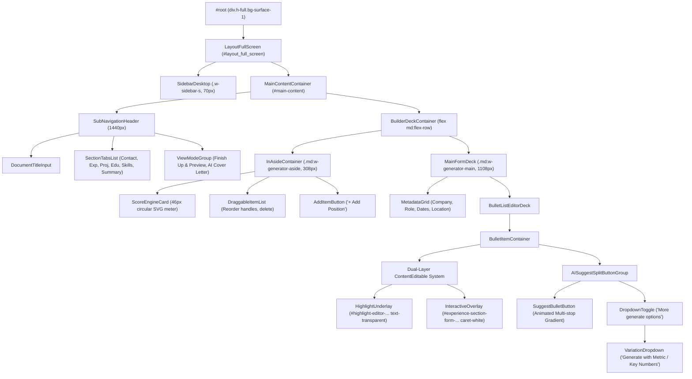

# REZI BUILDER REVERSE-ENGINEERED UX & ARCHITECTURAL SPECIFICATION

> **Origin:** Live Google Chrome Remote Debugging Protocol (CDP) session (`http://127.0.0.1:9222`)  
> **Target Application:** Rezi Resume Builder (`https://app.rezi.ai/dashboard/resume/hJaT3TaHT9iGI62VKW9e`)  
> **Extraction Date:** October 2026  
> **Scope:** Layout geometry, React DOM hierarchy, AI bullet authoring engine, ATS score system, and design tokens.

---

## 1. EXECUTIVE ARCHITECTURAL SUMMARY

Rezi's builder workspace operates as a hybrid split-screen desktop workstation optimized for fast text editing, real-time ATS scoring, and pixel-exact document previewing.

```
+----+-----------------------------------------------------------------------------+
|    | Sub-Navigation Header: Document Title | Section Tabs | View Mode Switchers  |
|    +------------------------+----------------------------------------------------+
| L  | In-Aside Panel (308px) | Center Form Deck (1108px max / flex-1)             |
| E  |                        |                                                    |
| F  | [Rezi Score Meter: 54] | [Section Header & Metadata Form]                   |
| T  |                        |                                                    |
|    | [Draggable Item Cards] | [Stacked ContentEditable Bullet Editor]            |
| R  | - Software Engineer    |   - Underlay: Syntax/pro highlight badges          |
| A  | - Frontend Lead        |   - Overlay: Caret input with real-time sync       |
| I  |                        |                                                    |
| L  | [+ Add Position]       | [AI Gradient Split Button: Suggest / Metric Mode]  |
|    |                        |                                                    |
| 70 |                        |                                                    |
| px |                        |                                                    |
+----+------------------------+----------------------------------------------------+
                                      ||
                             (Finish Up & Preview Mode)
                                      \/
+----+-----------------------------------------------------------------------------+
|    | Viewport Canvas Container: Dark Slate (`#1E293B`)                           |
| 70 | Scale: CSS transform: matrix(1.278, 0, 0, 1.278, 0, 0)                      |
| px | Paper Canvas: 816px (US Letter 8.5" @ 96 DPI) with dynamic Page Breakers    |
+----+-----------------------------------------------------------------------------+
```

---

## 2. SECTION 1: LAYOUT GEOMETRY & CSS GRID

### 2.1 Root Structure & Viewport Layout
- **Root Element:** `#root.h-full.bg-surface-1` (Background: `#0F172A`).
- **Main Container:** `#main-content` spanning 100vw minus the fixed left rail:
  * Left offset: `left: 70px` (`w-sidebar-s`).
  * Available width: `1637px` at 1707px viewport.
- **Builder Frame:** `#layout_full_screen` with a max-width wrapper:
  * Max width: `1440px` (responsive container padding: `px-4 md:px-8`).
  * Direction: `flex flex-col justify-start gap-4`.

### 2.2 Global Left Navigation Rail
- **DOM Selector:** `aside.w-sidebar-s` / `#sidebar-desktop`.
- **Dimensions:** Fixed `width: 70px` (`w-sidebar-s`), `height: 100vh`, `position: fixed`, `z-index: 40`.
- **Styling:**
  * Background: `rgb(15, 23, 42)` (`#0F172A`).
  * Border: `border-r border-slate-800`.
- **Navigation Items:** Vertical icon column (Home, Resumes, Cover Letters, Job Search, Settings).
  * Icon container: `44px x 44px`, `rounded-xl`, flex center.
  * Active state: High-contrast primary icon with subtle background tint (`bg-surface-2`).
  * Hover indicator: Tooltip with 200ms ease-in-out transition appearing to the right (`left-16`).

### 2.3 Sub-Navigation Header Bar
- **Dimensions:** `1440px max-width`, `height: 81px` (including `pt-4 pb-2`).
- **Layout:** Flex row with 3 distinct clusters:
  1. **Document Identity:** Title input (e.g. `ALI NASSAR`), status indicator, and breadcrumb.
  2. **Section Tabs (Center):** Pills for `CONTACT`, `EXPERIENCE`, `PROJECT`, `EDUCATION`, `SKILLS`, `SUMMARY`.
     - Inactive Tab: `text-slate-400 hover:text-white px-3 py-1.5 text-xs font-bold uppercase transition`.
     - Active Tab: `bg-primary-600 text-white rounded-full px-4 py-1.5 text-xs font-bold uppercase shadow-sm`.
  3. **View Mode Switchers (Right):**
     - `FINISH UP & PREVIEW` (`#unsafe-preview-nav-0`): Switches builder into interactive paper preview.
     - `AI COVER LETTER`: One-click cover letter generation linked to resume data.

### 2.4 Main Builder Deck (Two-Column Asymmetric Grid)
The builder deck uses a responsive flex/grid container:
```html
<div class="flex flex-col gap-y-4 pt-4 pb-8 md:flex-row gap-x-6">
  <!-- Left Column: Aside Deck -->
  <aside class="md:w-generator-aside flex-none">...</aside>
  <!-- Right Column: Main Form Deck -->
  <main class="experience-wrapper md:w-generator-main flex-1">...</main>
</div>
```
- **Left In-Aside Deck (`md:w-generator-aside`):**
  * Width: Exactly `308px` (22% of container).
  * Holds Rezi ATS Score Card (46px circular SVG gauge + breakdown teaser).
  * Holds draggable list of position/project entries with drag handles (`fa-grip-lines`) and delete buttons.
- **Center Form Deck (`md:w-generator-main`):**
  * Width: `1108px` max / `flex-1`.
  * Padding: `p-6 md:p-8`.
  * Background: Surface card (`#121826` / `#1E293B`).
  * Border: `border border-slate-800 rounded-xl`.

### 2.5 Right Canvas Viewport & Scaling Mechanics (Finish Up & Preview Mode)
When navigating to `/dashboard/resume/:id/finish-up`:
- **Viewport Canvas Container:** `#resume-preview`
  * Position: Absolute or centered relative flex viewport.
  * Background: Deep slate workspace (`rgb(30, 41, 59)` / `#1E293B`).
  * Padding: `24px` (`p-6`).
- **Dynamic Zoom Scaling Mechanics:**
  * Scaling Model: Evaluated dynamically using CSS matrix transform:
    ```css
    transform: matrix(1.27797, 0, 0, 1.27797, 0, 0);
    ```
    *(Equates to `transform: scale(1.278)` calculated via `containerWidth / paperWidth`).*
  * Origin: `transform-origin: top center` or `top left`.
- **Paper Canvas Element (`#resume`):**
  * Geometry: Standard US Letter Width = Exactly `816px` ($8.5\text{ in} \times 96\text{ DPI}$).
  * Background: `#FFFFFF`.
  * Content Padding: `49.13px` top ($0.51\text{ in}$ standard ATS margin).
- **Page Boundary & Overflow Demarcation:**
  * DOM Marker: `.design-studio-break-page` (`absolute -left-[5%] w-[110%] text-sm text-gray-600`).
  * Visual: Subtle dashed red/gray horizontal line with centered "Break" pill indicator.
  * Section Anchors: Each rendered resume block receives a telemetry anchor:
    `page-breaker__contact`, `page-breaker__summary`, `page-breaker__projects`, `page-breaker__education`, `page-breaker__skills`.

### 2.6 Responsive Breakpoints & Viewport Adaptations
| Breakpoint | Window Width | Layout Behavior | Left Rail (70px) | Aside (308px) | Main Form Deck |
|---|---|---|---|---|---|
| **XL** | $\ge 1440\text{px}$ | 2-Column Side-by-Side | Fixed Visible | 308px Fixed | 1108px (Flex-1) |
| **LG** | $1280\text{px}$ | 2-Column Side-by-Side | Fixed Visible | 308px Fixed | 644px (Flex-1) |
| **MD** | $1024\text{px}$ | Vertical Stack (`flex-col`) | Fixed Visible | 100% (960px) | 100% (960px) |
| **SM** | $768\text{px}$ | Vertical Stack (`flex-col`) | Fixed Visible | 100% (704px) | 100% (704px) |
| **Mobile**| $< 768\text{px}$ | Off-canvas Drawer / Bottom Sheet | Hidden / Bottom Bar | Bottom Sheet | 100% Full Width |

---

## 3. SECTION 2: REACT COMPONENT & DOM HIERARCHY

### 3.1 Component Tree Architecture


### 3.2 State Synchronization & Keystroke Propagation
1. User types inside `#experience-section-form-N` (`contenteditable`).
2. Input handler dispatches `updateFormTextArea(field, bulletIndex, htmlContent)`.
3. The React store updates the normalized resume draft tree:
   ```typescript
   interface ResumeDraftState {
     contact: ContactDetails;
     experience: WorkExperienceItem[];
     projects: ProjectItem[];
     education: EducationItem[];
     skills: SkillCategory[];
     summary: string;
   }
   ```
4. Synchronization Flow:
   - Synchronous DOM pass: Underlay highlighter computes syntax highlights (buzzwords, missing metrics, passive voice) and renders colorized `<span>` tags directly aligned behind user text.
   - Reactive Hook pass: Canvas Preview DOM updates `#page-breaker__*` elements. If the element exceeds the 1027px page boundary, `.design-studio-break-page` shifts position dynamically.

---

## 4. SECTION 3: THE "AI BULLET WRITER" INTERACTION PATTERN

### 4.1 Split-Button Anatomy & Styling
The AI bullet writer does not rely on buried submenus or intrusive full-screen modals. It is anchored directly beneath each bullet point input as a high-visibility gradient split button:

```
+-----------------------------------------------------+-----+
|  [✨] SUGGEST BULLET                                 |  v  |
+-----------------------------------------------------+-----+
(Rounded-l-full, Multi-stop animated linear gradient) (Rounded-r-2xl, border-l)
```

- **Primary Button (`rounded-l-full`):**
  * Classes: `relative flex items-center justify-center font-bold uppercase text-xs px-3 py-1.5 rounded-full! bg-primary-500! rounded-tr-none! rounded-br-none! pr-3 text-white`.
  * Animated Background:
    ```css
    background-image: linear-gradient(
      80deg,
      var(--color-primary-600) 0%,
      var(--color-primary-600) 10%,
      #b3241a 50%,
      #a63cac 70%,
      var(--color-primary-600) 90%,
      var(--color-primary-600) 100%
    );
    background-size: 800% auto;
    animation: loading 2s infinite;
    ```
  * Icons: 3 layered sparkle SVGs with varying opacities (`fill-neutral-0`).
- **More Options Split Trigger (`rounded-r-2xl`):**
  * Classes: `w-8 h-full rounded-l-none rounded-r-2xl border-l border-l-white bg-primary-600 hover:bg-primary-500 text-white flex items-center justify-center`.
  * Icon: `fa fa-angle-down text-sm`.
  * Tooltip: `More generate options`.

### 4.2 Mode-Aware Generation Variations
The AI generator component (`gl`) inspects the current bullet state (`new`, `rewrite`, or `add`) and renders context-appropriate variation options:

```typescript
function gl({ type, onSelect, disabled = false }) {
  let label = '';
  if (type === 'new') label = 'Generate with Metric / Key Numbers';
  if (type === 'rewrite') label = 'Rewrite with Key Metric';
  if (type === 'add') label = 'Complete with Key Numbers';

  // Desktop: Absolute Popover Menu / Mobile: Bottom Action Sheet
  return (
    <PopoverMenu open={isOpen} onClickOutside={() => setOpen(false)}>
      <MenuItem 
        icon="fad fa-bullseye-arrow" 
        text={label} 
        onClick={() => onSelect('keymetric')} 
      />
    </PopoverMenu>
  );
}
```

### 4.3 Dual-Layer Real-Time Syntax Highlighting
To provide real-time ATS feedback without causing cursor-jumping or DOM selection corruption during typing, Rezi isolates the display underlay from the interactive input:

1. **Layer 1: Highlight Underlay (Behind):**
   - Selector: `#highlight-editor-experience-section-form-4-highlight-warning`
   - Attributes: `!border-none text-transparent whitespace-pre-wrap pointer-events-none select-none`
   - Content: Mirrors the exact text string, but wraps problematic words in colored highlight spans:
     * Red underline span: Buzzwords (`synergized`, `rockstar`).
     * Yellow background span: Passive voice or missing numerical metrics.
     * Purple highlight span: Action verbs.
2. **Layer 2: Interactive ContentEditable (Foreground):**
   - Selector: `#experience-section-form-4`
   - Attributes: `text-node-placeholder min-h-44! border-2 border-input-stroke rounded-sm px-4 pt-3.5 pb-12 caret-white bg-transparent`
   - Role: Captures user keystrokes with transparent background, allowing the underlay badges to shine through precisely behind the text characters.

---

## 5. SECTION 4: ATS AUDIT & SCORE ENGINE

### 5.1 Gauge Meter Visual Anatomy
The score meter renders as an SVG circular progress meter in the left aside deck:
- **Dimensions:** `46px x 46px`.
- **SVG Parameters:**
  * Viewbox: `0 0 46 46`.
  * Rotation: `-rotate-90`.
  * Radius: $r = 19.78\text{px}$.
  * Circumference: $2 \pi r \approx 124.28\text{px}$ (`stroke-dasharray: 124.281`).
  * Stroke Offset for Score 54: `stroke-dashoffset: 57.1694`.
  * Dynamic Stroke Color: Amber warning `rgb(245, 158, 11)` (`#F59E0B`) for scores 50–69; Green (`#10B981`) for $\ge 70$; Red (`#EF4444`) for $< 50$.

### 5.2 Modal Scorecard & The 5 Audit Categories
Clicking the score meter opens `div[data-test-id="score-dialog"]` inside `#headlessui-portal-root`, rendering a large $236 \times 118\text{px}$ semi-circular gauge chart (`data-test-id="rezi-gauge-chart"`).

The engine audits the CV across **5 core categories**:

```
+------------------------------------------------------------------+
|                    REZI SCORE: 54 / 100                          |
|             "Needs Improvement - 8 Checks Requiring Action"      |
+---------------------+-------+------------------------------------+
| Category            | Score | Critical Checks                    |
+---------------------+-------+------------------------------------+
| 1. Content          |  58   | Bullet Count, Word Count, Metrics  |
| 2. Format           |  55   | Page Fit, Margin Balance, Spacing  |
| 3. Optimization     |   0   | Job Description Keyword Match      |
| 4. Best Practices   |  56   | Grammar, Pronouns, Passive Voice   |
| 5. Application Ready|  54   | Contact Accuracy, Valid Dates      |
+---------------------+-------+------------------------------------+
```

### 5.3 Concrete Audit Heuristics Extracted from Runtime Fiber
1. **Personal Pronoun Suppression:** Strictly prohibits `I`, `me`, `my`, `we`, `our`. Flagged instantly in Best Practices.
2. **Action Verb Diversity:** First word of every bullet MUST be a strong past-tense action verb (`Engineered`, `Orchestrated`, `Implemented`). Duplicate verbs across roles are penalized.
3. **Bullet Count Rule:** Enforces between **3 and 6 bullets** per work experience item. 1 or 2 bullets triggers "Insufficient experience depth"; $>6$ bullets triggers "Overly verbose".
4. **Achievement Quantification (The Metric Rule):** Flags any bullet lacking numbers, percentages, or timeframes. Prompts variation: "Generate with Metric / Key Numbers".
5. **Page Length Budget:**
   - 1-Page Target: 0.8 to 1.0 page height is scored as 100%.
   - Over-budget penalty: Overflowing onto page 2 with less than 0.5 page triggers an automatic 20-point deduction in Format.
6. **Total Word Count Budget:** 400 to 800 words total across the entire CV.
7. **Summary Brevity:** Maximum 2 lines (~30 to 45 words). Disallows multi-paragraph narrative summaries.

---

## 6. SECTION 5: DESIGN TOKENS & VISUAL CRAFT

### 6.1 Color Palette
```css
:root {
  /* Surface Layers */
  --color-surface-1: #0F172A; /* Global background & side rail */
  --color-surface-2: #1E293B; /* Card containers & form deck */
  --color-surface-3: #020617; /* High-contrast popovers & tooltips */
  
  /* Primary & Brand Accents */
  --color-primary-500: #8A9AFF; /* Hover indigo */
  --color-primary-600: #6366F1; /* Primary action button & active pills */
  --color-primary-700: #4F46E5; /* Active/pressed state */
  
  /* Status & Audit Indicators */
  --color-status-success: #10B981; /* Score 70-100 */
  --color-status-warning: #F59E0B; /* Score 50-69 */
  --color-status-danger:  #EF4444; /* Score 0-49 & Underlay warnings */
  
  /* Typography Colors */
  --color-text-primary:   #F3F4F6; /* Gray-100 body text */
  --color-text-secondary: #94A3B8; /* Slate-400 labels & metadata */
  --color-text-disabled:  #64748B; /* Slate-500 placeholders */
  
  /* Borders & Strokes */
  --color-border-subtle:  #1E293B; /* Slate-800 divider lines */
  --color-border-input:   #334155; /* Slate-700 input borders */
  --color-border-focus:   #8A9AFF; /* Primary indigo input ring */
  
  /* Canvas Paper */
  --color-canvas-bg:      #1E293B; /* Dark slate preview backdrop */
  --color-paper-sheet:    #FFFFFF; /* Pure white A4/Letter paper */
}
```

### 6.2 Typography Tokens
- **Font Stack:** `"Source Sans Pro", -apple-system, BlinkMacSystemFont, "Segoe UI", Roboto, sans-serif`.
- **Scale:**
  * Display Header: `24px` (`leading-8`, `font-bold`).
  * Section Title: `18px` (`leading-6`, `font-semibold`, `tracking-wide`).
  * Form Deck Labels: `12px` (`uppercase`, `font-bold`, `tracking-wider`, `text-slate-400`).
  * Input Fields: `16px` (`font-semibold`, `text-gray-100`).
  * Button Labels: `14px` (`uppercase`, `font-bold`, `tracking-wider`).
  * Tooltips: `12px` (`leading-4`, `font-normal`).

### 6.3 Radii & Elevation Tokens
- **Borders & Radii:**
  * Small Badges: `4px` (`rounded`).
  * Standard Buttons & Form Inputs: `6px` (`rounded-md`).
  * Asymmetric Split Button: Left `rounded-l-full`, Right `rounded-r-2xl`.
  * Cards & Containers: `12px` (`rounded-xl`).
  * Nav Pills: `9999px` (`rounded-full`).
- **Elevation & Shadows:**
  * Floating Modals: `0px 20px 25px -5px rgba(0, 0, 0, 0.5), 0px 8px 10px -6px rgba(0, 0, 0, 0.5)`.
  * In-App Popovers: `0px 4px 6px -1px rgba(0, 0, 0, 0.3), 0px 2px 4px -2px rgba(0, 0, 0, 0.3)`.

---

## 7. RECOMMENDATIONS FOR 42BEIRUT-RECRUIT OVERHAUL

To achieve commercial-grade parity with Rezi while maintaining 42 Beirut's engineering identity:

1. **Adopt the Asymmetric Builder Deck:**
   Transition `Step4SplitEditor.tsx` to the `308px` aside (holding Dr. Wissam ATS rule compliance and draggable 42 project cards) paired with an `1108px` focused form deck.
2. **Implement Dual-Layer Highlighting:**
   Replace raw `textarea` inputs with the dual-layer `contenteditable` architecture to highlight duplicate action verbs, missing technical metrics, and 42 Piscine buzzwords in real time.
3. **Integrate Animated AI Split Buttons:**
   Replace the monolithic "Synthesize All" button with localized split action triggers: `SUGGEST BULLET` + `Generate with Peer Metric` (e.g. Piscine test cases, C memory benchmarks).
4. **Deploy Real-Time SVG ATS Gauge:**
   Integrate the 46px circular progress gauge in the editor navigation, wired to the Dr. Wissam rule engine (1-page budget, verb rotation, Piscine project verification).
