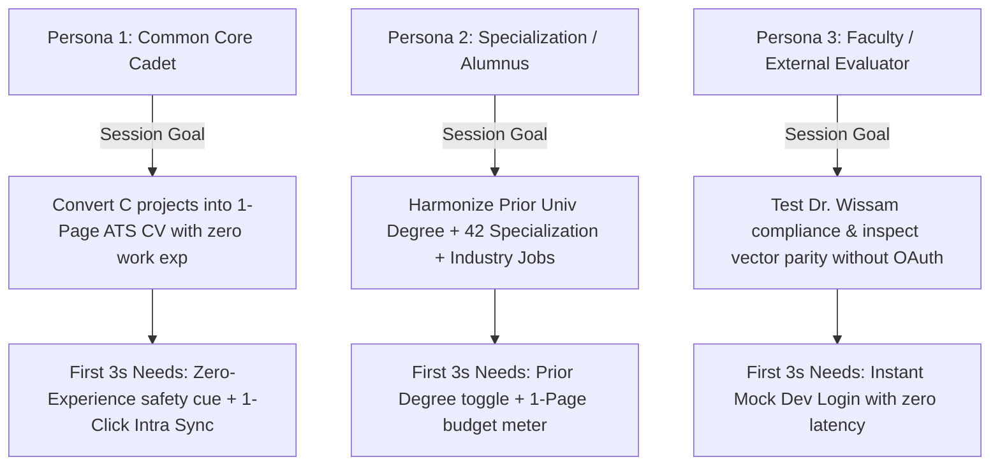
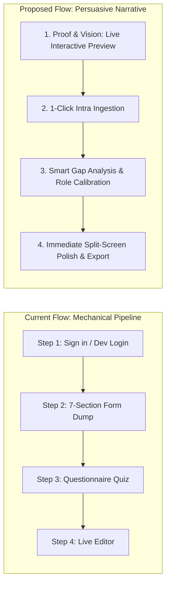
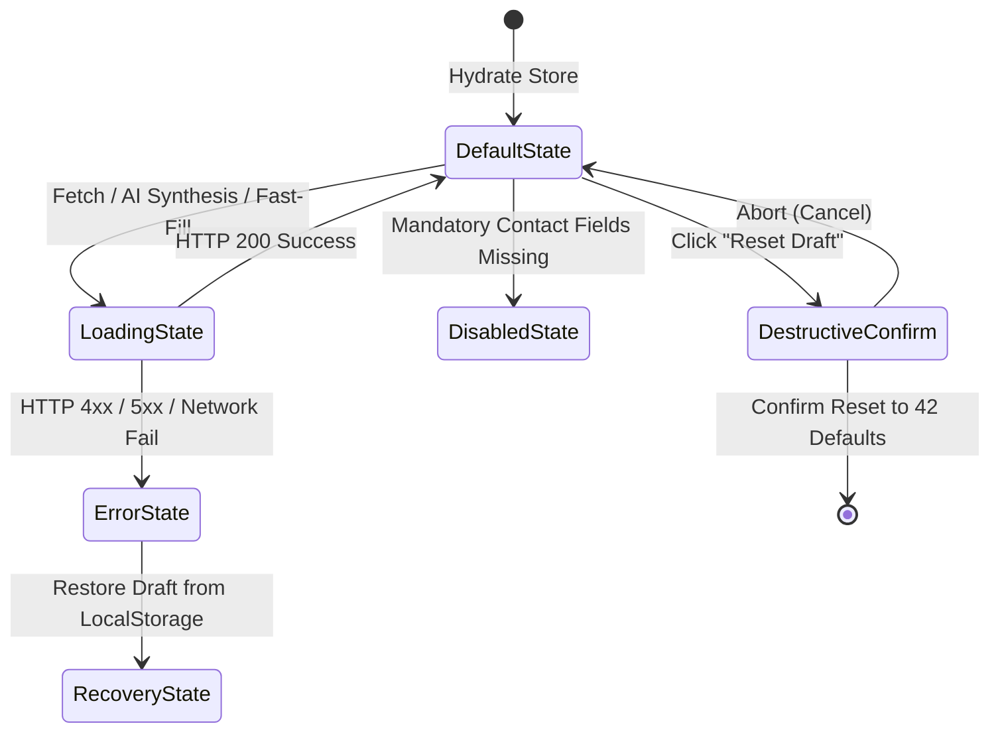

# [SYSTEM ORCHESTRATION: MULTI-AGENT UI/UX EXTRACTION & ARCHITECTURAL AUDIT]

**Project:** `42Beirut-Recruit`  
**Target:** Full Frontend Architecture, Design Token Discipline, Interaction Telemetry & State FSM  
**Lead UX Systems Director:** Antigravity Executive Panel  
**Audit Scope:** `c:/Users/Ali_n/Desktop/CV-Builder`

---

## EXECUTIVE SUMMARY & AUDIT METHODOLOGY

This comprehensive audit evaluates the entire user-experience surface of `42Beirut-Recruit`—from initial OAuth ingress to final vector print and `.docx` binary generation. Over 8,000 lines of UI and state logic were analyzed across:
- **Application Core:** `src/app/page.tsx`, `src/app/layout.tsx`, `src/app/globals.css`
- **Wizard Progression:** `src/components/wizard/BreadcrumbStepper.tsx`, `Step1Login.tsx`, `Step2ProjectSetup.tsx`, `Step3Questionnaire.tsx`, `Step4SplitEditor.tsx`
- **Visual Canvas:** `src/components/templates/WissamCleanTemplate.tsx`
- **State Store & Knowledge Base:** `src/lib/store/cv-store.ts`, `src/lib/knowledge-base.ts`, `src/types/resume.ts`
- **API Interfaces:** `src/app/api/ai/generate-cv/route.ts`, `src/app/api/ai/parse-old-cv/route.ts`, `src/app/api/auth/42/login/route.ts`

---

## AGENT 1: COGNITIVE FLOW & PRODUCT INTENT ARCHITECT

### 1. Primary Persona Intent Mapping



#### Persona 1: The Common Core Cadet (Junior / Internship Seeker)
- **Context:** Currently at Level 4–9 in the 42cursus (working through `minishell`, `philosophers`, or `cub3d`). They possess strong Unix and C fundamentals but have zero prior formal tech jobs.
- **#1 Session Goal (JTBD):** Generate a legitimate, ATS-compliant 1-page engineering resume that translates low-level C projects into modern technical achievements without leaving an embarrassing half-page blank void.
- **First 3 Seconds Critical Cue:** Must immediately see the assurance that **lacking work experience will not penalize them**, and that the system will automatically reallocate vertical space to expand selected projects.
- **Code Anchor:** Handled in `src/lib/intra/mock-data.ts#L78-L86` and `src/components/wizard/Step2ProjectSetup.tsx#L625-L627`:
  ```tsx
  <strong>Dr. Wissam Dynamic Rule:</strong> If you have no work experience yet, toggle this OFF.
  The engine will automatically expand your Selected Projects section so your CV remains a full, balanced 1-page document.
  ```

#### Persona 2: The Specialization Cadet / Alumnus (Mid / Senior Seeker)
- **Context:** Validated `ft_transcendence` or achieved Level $\ge 10.0$ (`STATE_B_SPECIALIZATION` or `STATE_C_ALUMNUS`). Often holds a prior Bachelor's degree (e.g., Lebanese University, LAU, AUB) and has 1–2 internships or freelance gigs.
- **#1 Session Goal (JTBD):** Merge external university credentials, specialized 42 tracks, and commercial work experience onto a single page without overflowing onto an untidy second page.
- **First 3 Seconds Critical Cue:** A visible **Prior University Degree** toggle and an instant **1-Page Height Budget Meter** showing real-time millimeter/pixel margin headroom.
- **Code Anchor:** `src/components/wizard/Step2ProjectSetup.tsx#L477-L502` and `src/components/wizard/Step4SplitEditor.tsx#L309-L337`.

#### Persona 3: Faculty, Reviewer, or Evaluator (Guest / Non-OAuth Tester)
- **Context:** Campus director, recruiter, or peer evaluator who wants to verify template conformance without authenticating against `api.intra.42.fr` or dealing with 42 OAuth token provisioning.
- **#1 Session Goal (JTBD):** Immediately inspect a fully populated, realistic CV adhering to Dr. Wissam's rules without being blocked by OAuth firewalls.
- **First 3 Seconds Critical Cue:** A prominent **"Quick Start with 42 Beirut Cadet Profile"** button that bypasses OAuth and hydrates the entire store with mock data.
- **Code Anchor:** `src/components/wizard/Step1Login.tsx#L11-L14`:
  ```tsx
  const handleDevLogin = () => {
    setStudentProfile(MOCK_42_STUDENT);
    setCurrentStep("SETUP");
  };
  ```

---

### 2. Route & Screen Inventory

The application operates as a Client-Side Single Page Application (SPA) driven by Zustand wizard state (`currentStep: "LOGIN" | "SETUP" | "QUESTIONNAIRE" | "EDITOR"`) hosted at root `/` (`src/app/page.tsx`):

| Screen / Modal Name | Route / Modal Trigger | Primary User Action | Preceding View (Origin) | Next Destination | Dead-End Risks & Fallback Defects |
|:---|:---|:---|:---|:---|:---|
| **Step 1: Auth & Ingress** | `/` (`currentStep === "LOGIN"`) | Authenticate via 42 OAuth or click Quick Start | Browser landing / direct entry | `SETUP` (Step 2) | 1. If OAuth fails at redirect, returns with `?error=...` (`page.tsx#L126`). If the user closes the top red banner, they are left on Step 1 with no feedback.<br>2. Cloudflare firewall block on `api.intra.42.fr` triggers residential bridge loading loop without an obvious "skip" escape hatch. |
| **Step 2: Setup & Experience** | `/` (`currentStep === "SETUP"`) | Fill contact info, select 3–4 projects, configure degrees | `LOGIN` (Step 1) or Stepper jump | `QUESTIONNAIRE` (Step 3) | **High Risk:** Button `Continue to Questionnaire` (`Step2ProjectSetup.tsx#L1388`) is disabled with `cursor-not-allowed` if contact info is invalid, but there is no auto-scroll to the missing input. A user at the bottom of the page is confused why the button won't click. |
| **Custom Project Builder** | Inline Expander (`Step2ProjectSetup.tsx#L852`) | Save custom personal project slug and stack | Section 5 in `Step2ProjectSetup` | Adds item to `customProjects` grid | If user clicks "Cancel" (`#L861`), inputs are not cleared unless cancelled; typing Enter in project name does not submit. |
| **Step 3: Technical Discovery** | `/` (`currentStep === "QUESTIONNAIRE"`) | Answer project questionnaire and write personal notes | `SETUP` (Step 2) | `EDITOR` (Step 4) | **Critical Risk:** If required personal note is `< 5` chars, clicking `Generate Dr. Wissam CV` (`Step3Questionnaire.tsx#L473`) shows an inline amber error, but does not auto-scroll to the incomplete project card. |
| **Step 4: Split Editor & Export** | `/` (`currentStep === "EDITOR"`) | Real-time split-screen text edit, Auto-Fit, PDF/DOCX Export | `QUESTIONNAIRE` (Step 3) or Stepper jump | Native print dialog / File download | If the user deletes all bullets for a project, the template renders an empty `<ul>` bullet container, causing visual indentation defects. |
| **Reset Draft Confirmation Modal** | Global Modal (`BreadcrumbStepper.tsx#L224`) | Confirm destructive purge of draft | "Reset Draft" button in header | Clears localStorage, re-initializes from Intra | Hitting the "Escape" key does not close the modal; only clicking "Cancel" or backdrop works. |
| **BYOK AI Settings Modal** | Modal in Step 4 (`Step4SplitEditor.tsx#L1282`) | Enter personal Google Gemini or Groq API keys | "AI Keys (BYOK)" button | Saves to `localStorage`, dismisses modal | No key validation ping (`probe`) upon entering keys; users only find out keys are invalid when synthesis fails. |

---

### 3. Information Hierarchy & Hero Diagnosis

```mermaid
flowchart TD
    subgraph Step 2: Information Hierarchy Flaw
        A1[1. Mandatory Contact Info - 6 Fields] --> A2[2. 42 Education Milestone - Radio + Inputs]
        A2 --> A3[3. Target Role - Pills + Input]
        A3 --> A4[4. Work Experience - Toggle + Dynamic Form]
        A4 --> A5[5. Projects Picker - 12+ Cards + Custom Project Form]
        A5 --> A6[6. Technical Skills - 4 Chip Categories]
        A6 --> A7[7. Campus Roles & Piscines - 10+ Checkboxes]
        A7 --> A8[Action: Continue to Questionnaire]
    end
    style A1 fill:#1e293b,stroke:#00BABC,stroke-width:2px
    style A8 fill:#0f172a,stroke:#f59e0b,stroke-width:2px
```



#### Diagnosis of Landing & Dashboard Views:
1. **Step 1 Landing Hero (`Step1Login.tsx#L21-L75`):**
   - **Diagnosis:** The screen is styled as a solitary dialog box floating in an empty dark void (`min-h-[85vh] flex items-center justify-center`). 
   - **Wasted Real Estate:** Over 60% of viewport width and 40% of vertical height is inert `bg-slate-950` background.
   - **Buried Value Proposition:** It asserts compliance with Dr. Wissam's template, but does **not show a thumbnail, skeleton, or interactive preview of what the output looks like**. Users have to take the tool's credibility on faith before committing to login.
2. **Step 2 Form Fatigue (`Step2ProjectSetup.tsx`):**
   - **Diagnosis:** 1,403 lines of continuous, un-paginated forms arranged in 7 vertical sections.
   - **Cognitive Overload:** Instead of progressive disclosure, the cadet is asked to review contact info, specify university history, configure internships, select projects, customize technical skill tags across 4 categories, and choose campus leadership roles all before ever seeing what their CV looks like.
   - **Buried Primary Action:** The "Continue to Questionnaire" CTA is buried at line 1388 at the very bottom of a 3,500px scroll container.
3. **Step 4 Live Editor Layout (`Step4SplitEditor.tsx`):**
   - **Diagnosis:** Superior information hierarchy compared to Steps 1–3. The left pane (480px) houses organized tabs (`Projects`, `Experience`, `Education`, `Skills`, `Header`, `Layout`), and the right pane displays the live A4 paper sheet.
   - **Issue:** The left editor tab bar overflows horizontally on sub-1280px viewports without visual gradient scroll indicators.

---

## AGENT 2: VISUAL CRAFT & "ANTI-SLOP" AUDITOR

```
+---------------------------------------------------------------------------------------------------------+
|                                    VISUAL CRAFT AUDIT SCORECARD                                         |
+---------------------------------------------------------------------------------------------------------+
| CATEGORY                         | GRADE | PRIMARY SYMPTOM                                              |
| Design Token Discipline          | C-    | tailwind.config.ts brand tokens bypassed in favor of ad-hoc |
| Visual Rhythm & Layout Symmetry  | C     | Identical 4-grid and 2-grid card repetition                  |
| Narrative Persuasion             | D+    | Feature-dump wizard with zero visual output preview on entry |
| Typography & Hierarchy           | B-    | Mixed font stacks (Inter vs Geist vs Calibri)               |
| Visual Identity / Signature      | B+    | Live Height Budget Meter + Dual-Chamber dark/paper contrast |
+---------------------------------------------------------------------------------------------------------+
```

### 1. AI "Slop" Checklist & Pattern Detection

1. **Centered-by-Default Symmetrical Card (`Step1Login.tsx#L21-L34`):**
   - Card container: `max-w-md w-full bg-slate-900/90 border border-slate-800 rounded-2xl p-8 text-center`.
   - Centered icon in a rounded box (`w-16 h-16 rounded-2xl bg-cyan-500/10`), centered H1, centered subtitle, followed by two full-width stacked buttons. This is a generic AI-generated auth modal with zero custom typographic posture.
2. **Repetitive Equal-Weight Card Grids (`Step2ProjectSetup.tsx#L1035-L1279`):**
   - Section 6 (Technical Skills) renders a rigid 4-card 2x2 grid where every single card (`Languages`, `Developer Tools`, `Technologies/Frameworks`, `Project Management Tools`) possesses identical padding, identical borders, and identical input affordances regardless of content volume.
3. **Vague Marketing Boilerplate:**
   - `Step1Login.tsx#L47`: `"Zero robotic fluff • Grounded engineering tone"`
   - `Step3Questionnaire.tsx#L152-L153`: `"The short personal note guarantees the Anti-Duplication Engine generates 100% unique bullet points tailored to your code."`
   - *Critique:* Stating "zero robotic fluff" in marketing copy is ironic and reads like an AI prompt instruction that leaked into user-facing text.
4. **Unmotivated Whitespace:**
   - Step 3 header (`Step3Questionnaire.tsx#L137-L155`) consumes 180px of vertical height just for title and subtitle before the first project card appears.

---

### 2. Narrative Sequence Check



The current application flow is structured as a **mechanical form pipeline**, not a persuasive narrative:
- **What it lacks:** 
  1. *Who it's for:* Doesn't show relatable cadet personas (e.g. "Core Cadet with Minishell" vs "Transcendence Alumnus").
  2. *Proof:* The user never sees a side-by-side demonstration of an ATS rejection vs. Dr. Wissam's clean single-column format until Step 4.
  3. *Immediate Gratification:* The cadet must execute 4 multi-stage steps before getting visual confirmation that the engine works.

---

### 3. Design System & Token Grounding

#### Color Token Fragmentation Analysis:
The design system defined in `tailwind.config.ts` is decoupled from the code used across the application:

```typescript
// tailwind.config.ts
colors: {
  background: "var(--background)",
  foreground: "var(--foreground)",
  brand: {
    42: "#00BABC",       // Defined but rarely referenced via 'text-brand-42'
    dark: "#0B0F19",     // Bypassed
    muted: "#4B5563",    // Bypassed
    card: "#121826",     // Bypassed
    border: "#1F2937",   // Bypassed
  },
}
```
**Actual Implementation in JSX:**
- Dark backgrounds use Tailwind default palette: `bg-slate-950` (`#020617`) and `bg-slate-900` (`#0f172a`).
- Brand cyan uses Tailwind defaults: `text-cyan-400` (`#22d3ee`) and `bg-cyan-500` (`#06b6d4`), completely ignoring the official 42 teal `#00BABC` defined in config.
- Border tokens: `border-slate-800` (`#1e293b`) and `border-cyan-500/30`.

#### Typography Token Audit:
- **Application Shell:** `Inter` imported in `src/app/layout.tsx#L5`.
- **Tailwind Config:** `fontFamily.sans: ["var(--font-geist-sans)", "Calibri", "sans-serif"]` (`tailwind.config.ts#L23`). Geist is declared in config but never loaded or used.
- **Printed Resume Document:** Hardcoded in `WissamCleanTemplate.tsx#L88`:
  ```typescript
  const fontPrimary = "'Calibri', 'Arial', sans-serif";
  ```
- **Scale Ratios:**
  - Name: `20pt` (Standard) / `18pt` (Compact)
  - Section Headings: `10.5pt` (Standard) / `10pt` (Compact)
  - Body Bullets: `9.5pt` (Standard) / `9pt` (Compact)
  - Line Heights: `1.35` (Standard) / `1.25` (Compact)

#### Spacing, Elevation & Border Radii:
- **Radii:** Components haphazardly oscillate between `rounded-lg` (8px), `rounded-xl` (12px), `rounded-2xl` (16px), and `rounded-full`.
- **Elevation:** Over-relies on `shadow-2xl` coupled with `shadow-cyan-500/20` glow effects on action buttons.

---

### 4. Proposed Visual Signature

To elevate `42Beirut-Recruit` above generic AI-generated interfaces, the UI should strictly implement two consistent visual motifs across all views:

```
+-----------------------------------------------------------------------------------------------------+
| MOTIF 1: THE "DUAL-CHAMBER" PRECISION ARCHITECTURE                                                  |
| Dark Command Chamber (Dark Slate / Terminal Cyan) <=====> Physical White A4 Canvas (96 DPI Vector) |
| Left: #0B0F19 Dark IDE with Monaco/Geist mono telemetry.                                            |
| Right: #FFFFFF Crisp sheet with realistic drop-shadow, page boundary guides, and live mm ruler.      |
+-----------------------------------------------------------------------------------------------------+
| MOTIF 2: PERSISTENT A4 HEIGHT BUDGET TELEMETRY PILL                                                 |
| [ * 1-Page Fit (94% Budget - 965px / 1027px) ]                                                      |
| Real-time dynamic SVG progress arc that shifts from Cyan (Healthy) to Amber (>98%) to Crimson (100%+) |
| with 1-click "Auto-Fit" compression trigger.                                                        |
+-----------------------------------------------------------------------------------------------------+
```

---

## AGENT 3: FINITE STATE MACHINE & RESILIENCE ENGINEER

### Comprehensive 8-State Component Resilience Matrix



| Component Name & Source Location | UI State | Current Behavior & Defect | Resilience Assessment | Concrete Remediating Fix |
|:---|:---|:---|:---|:---|
| **Step1Login**<br>`Step1Login.tsx#L16` | **Loading** | Redirects browser to `window.location.href = "/api/auth/42/login"`. The button shows no loading spinner during the redirect wait. | Broken | Wrap in `useState(isRedirecting)` and render `<Loader2 className="animate-spin" />` with text *"Connecting to Intra..."*. |
| **Old CV Dropzone**<br>`Step2ProjectSetup.tsx#L232-L260` | **Error** | If file is corrupted or Gemini key rate-limits, error is set in `uploadErrorMsg` (`#L271`), but the dropzone remains in a failed visual state until page refresh. | Fragile | Add a "Retry" or "Dismiss" button next to the error notice; auto-clear file input ref. |
| **Projects Picker**<br>`Step2ProjectSetup.tsx#L783-L826` | **No Results** | If student has 0 validated projects or an empty array, the section renders an empty grid with zero prompt. | Missing | Render an Empty State card: *"No validated projects found in Intra profile. Click '+ Add Personal Project' below to manually add your software."* |
| **Contact Info Section**<br>`Step2ProjectSetup.tsx#L306-L408` | **Inline Error** | Only phone has amber border `!isPhoneValid ? "border-amber-500/50" : "..."`. Name, email, LinkedIn, and GitHub inputs have **no visual validation highlighting** when empty. | Incomplete | Apply uniform red border `!isEmailValid && "border-red-500/50 focus:border-red-400"` with inline microcopy below each required input. |
| **Step 2 Action Bar**<br>`Step2ProjectSetup.tsx#L1388-L1399` | **Disabled** | Button is disabled if `!isContactValid || selectedProjects.length === 0`. The disabled status has no tooltip or indicator explaining which condition failed. | Usability Drag | Add tooltip or contextual error message: *"Select at least 1 project and complete required contact fields to proceed."* |
| **Questionnaire Synthesize**<br>`Step3Questionnaire.tsx#L125` | **Error** | Invokes blocking browser native `alert("Synthesis error: " + data.error)`. Destroys user experience and halts execution thread. | **Critical Flaw (P0)** | Replace `alert()` with an in-app animated error modal with an auto-retry button and fallback option. |
| **Questionnaire Synthesis**<br>`Step3Questionnaire.tsx#L481-L492` | **Loading** | Shows `<Loader2 className="animate-spin" /> Synthesizing 100% Unique CV...` on the button, but the rest of the view is frozen with no progress bar or skeleton. | Fragile | Display a modal overlay with step progress: *1/3 Checking anti-duplication ledger... 2/3 Synthesizing bullets... 3/3 Formatting template...* |
| **Split Editor Project Removal**<br>`Step4SplitEditor.tsx#L570` | **Destructive Confirmation** | Clicking `<Trash2 className="w-3.5 h-3.5" />` instantly deletes the project and all custom bullet points with **zero confirmation and no undo buffer**. | **Critical Flaw (P0)** | Implement two-step confirmation or an undo toast buffer: *"Project removed. [Undo]"* persisting for 6 seconds. |
| **Split Editor Experience Toggle**<br>`Step4SplitEditor.tsx#L897-L908` | **Empty** | Experience toggle is OFF: renders informative card explaining space reallocation. | Healthy | Maintain current pattern. |
| **Document Canvas Overflow**<br>`WissamCleanTemplate.tsx#L108-L117` | **Recovery / Warning** | When height exceeds 1027px, displays dashed amber border cutoff at 1123px with warning badge. | Healthy | Maintain current pattern. |
| **Local Draft Persistence**<br>`src/app/page.tsx#L335-L373` | **Recovery** | Displays top draft restoration banner with "Continue Editing" and "Reset to 42 Intra Defaults". | Healthy | Ensure dismiss action is remembered in session storage so it doesn't reappear on minor route changes. |

---

## AGENT 4: INTERACTION FRICTION & CLICK-DEPTH PROFILER

### 1. Workflow Click-Depth Telemetry

```
+------------------------------------------------------------------------------------------------------------------------+
|                                           HIGH-FREQUENCY WORKFLOW TELEMETRY                                            |
+------------------------------------------------------------------------------------------------------------------------+
| WORKFLOW                              | CLICKS | ROUTE / STEP TRANSITIONS | MODALS / PROMPTS | CLICK DEPTH EVALUATION  |
| 1. Fresh Start -> Export Clean PDF    | 9      | 3 (Login -> Setup -> Q)  | 0                | Excessive friction (P1) |
| 2. Toggle Experience & Re-fit 1-Page  | 3      | 0 (In-Editor)            | 0                | Optimal & efficient     |
| 3. Add Custom Outside 42 Project      | 7      | 1 (Setup view scroll)    | 1 (Expander)     | Moderate drag (P2)      |
+------------------------------------------------------------------------------------------------------------------------+
```

#### Detailed Breakdown of Workflow 1 (Fresh Start -> Export Clean PDF):
1. Land on `/` (Step 1): Click "Quick Start with 42 Beirut Cadet Profile" `[Click 1]`
2. Hydrated into Step 2: User must scroll down past Contact, Milestones, Role, Experience to Projects.
3. Select 4 Projects: `[Clicks 2, 3, 4, 5]`
4. Scroll to bottom of Step 2: Click "Continue to Questionnaire" `[Click 6]`
5. Land on Step 3: Required to provide personal notes for each selected project. Clicking 1-click chips for 4 projects: `[Clicks 7, 8, 9, 10]`
6. Scroll to bottom of Step 3: Click "Generate Dr. Wissam CV" `[Click 11]`
7. Wait 5–10s for Gemini AI inference.
8. Land on Step 4 (Editor): Move cursor to top right and click "Export PDF (Vector)" `[Click 12]`
9. Native Browser Print dialog appears: Click "Save/Print" `[Click 13]`
- **Telemetry Verdict:** **13 physical clicks** and **3 full-viewport scroll journeys** required to produce a first document. The user is prevented from seeing any live document until Click 11.

---

### 2. Navigation Anchors & Context Preservation

#### Where Am I?
- **Current State:** The sticky header (`BreadcrumbStepper.tsx#L98-L221`) provides a 4-step stepper (`Intra Sync` $\to$ `Setup & Experience` $\to$ `Technical Discovery` $\to$ `Live Editor & Export`).
- **Context Flaw:** When the user is in `Step2ProjectSetup.tsx`, the page is over 3,000 pixels tall. As they scroll through the 7 sections, there is **no sub-navigation anchor** (e.g., sticky table of contents or section progress dots). The user easily loses context of whether they are editing Skills, Coursework, or Projects.

#### What Workspace / Profile Context Is Active?
- **Current State:** Displays the cadet's name (`cvData.contact.fullName`) and autosave timestamp in the header (`BreadcrumbStepper.tsx#L123-L206`).
- **Strength:** The autosave indicator (`"Saved just now"` / `"Saved 2m ago"`) with pulsing green dot provides continuous psychological reassurance.

#### How Do I Return?
- **Current State:** Clicking completed step pills in the breadcrumb bar allows direct jumping.
- **Flaw:** If the user jumps back from Step 4 (Editor) to Step 2 (Setup) to toggle a project, then returns to Step 4, any custom edits made in the editor bullets risk being overwritten if they click "Generate" in Step 3 again.

---

### 3. Micro-Copy & Action Consistency Audit

The interface suffers from erratic action-verb drift across its views:

```
+---------------------------------------------------------------------------------------------------------+
| VERB DRIFT AUDIT                                                                                        |
+---------------------------------------------------------------------------------------------------------+
| ACTION INTENT               | COMPONENT & LOCATION                 | CURRENT LABEL                      |
| Start Workflow              | Step1Login.tsx#L59                   | "Quick Start with 42..."           |
| Start Workflow              | Step1Login.tsx#L67                   | "Sign in with 42 Intra..."         |
| Add Entity                  | Step2ProjectSetup.tsx#L677           | "Add Another Job / Internship"     |
| Add Entity                  | Step2ProjectSetup.tsx#L846           | "Add Personal Project"             |
| Save Entity                 | Step2ProjectSetup.tsx#L930           | "Save & Include Project"           |
| Add Skill                   | Step2ProjectSetup.tsx#L1091          | "Add"                              |
| Add Coursework              | Step2ProjectSetup.tsx#L1368          | "Add"                              |
| AI Generation               | Step3Questionnaire.tsx#L489          | "Generate Dr. Wissam CV"           |
| AI Re-generation            | Step4SplitEditor.tsx#L670            | "Regenerate with Fresh Angle"      |
| Formatting Compression      | Step4SplitEditor.tsx#L334            | "Auto-Fit 1-Page"                  |
| Text Trimming               | Step4SplitEditor.tsx#L620            | "Shorten"                          |
| Verb Cycling                | Step4SplitEditor.tsx#L632            | "Rotate"                           |
+---------------------------------------------------------------------------------------------------------+
```

#### Ambiguous & Problematic Micro-Copy Instances:
1. **"Rotate" Button (`Step4SplitEditor.tsx#L632`):**
   - The label "Rotate" is cryptic. A user might assume it rotates page orientation or layout. It actually cycles the opening action verb (e.g. from "Built" $\to$ "Engineered" $\to$ "Architected"). It should be renamed: **"Cycle Verb"** or **"Swap Verb"**.
2. **"Shorten" Button (`Step4SplitEditor.tsx#L620`):**
   - Clear action, but does not provide immediate feedback on how many characters or millimeters were saved.
3. **"State A", "State B", "State C" Pills (`Step2ProjectSetup.tsx#L430-L455`):**
   - Labeled "State A: In Core", "State B: Specialization", "State C: Alumnus". Internal architectural state names (`State A/B/C`) leak into the UI. Should be simply: **"Common Core"**, **"Specialization"**, and **"Alumnus / Graduate"**.

---

## AGENT 5: SYNTHESIS & SEVERITY TRIAGE DIRECTOR

Consolidated engineering and design backlog triaged by severity:

```
+--------------------------------------------------------------------------------------------------------+
|                                  PRIORITIZED ISSUE SEVERITY MATRIX                                     |
+--------------------------------------------------------------------------------------------------------+
| PRIORITY LEVEL              | COUNT | CORE THEME                                                       |
| P0 (Blocker)                | 3     | Thread-blocking alerts, unconfirmed data deletion, silent blocks |
| P1 (Critical Friction)      | 4     | Form fatigue, missing search, blind synthesis wait, token drift  |
| P2 (Usability Drag)         | 4     | Click depth, hidden field errors, cryptic microcopy, zoom cutoff |
| P3 (Visual Polish)          | 3     | Card symmetry, marketing slop, unmotivated hero whitespace       |
+--------------------------------------------------------------------------------------------------------+
```

### P0 (Blockers): Critical State Missing, Data Loss, or Broken Journey

#### Issue 1: Blocking Browser `alert()` on Synthesis & DOCX Generation Failures
- **Impacted Components:** 
  - `src/components/wizard/Step3Questionnaire.tsx#L125` (`alert("Synthesis error: " + ...)`)
  - `src/components/wizard/Step3Questionnaire.tsx#L129` (`alert("Failed to synthesize CV: " + ...)`)
  - `src/components/wizard/Step4SplitEditor.tsx#L204` (`alert("Failed to export Word document: " + ...)`)
  - `src/components/wizard/Step4SplitEditor.tsx#L273` (`alert("Failed to regenerate bullets: " + ...)`)
- **Root Cause:** Raw browser `window.alert()` calls halt the JavaScript thread, freeze animations, and fail completely in headless or modal webview contexts.
- **Recommended Fix:** Replace with an inline toast notification (`toastMessage`) or dedicated error modal providing the exact error reason, API failover status, and an automated "Retry" button.

#### Issue 2: Accidental Project & Experience Deletion Without Confirmation or Undo
- **Impacted Components:**
  - `src/components/wizard/Step4SplitEditor.tsx#L570` (`removeProjectFromCV(proj.id)`)
  - `src/components/wizard/Step4SplitEditor.tsx#L752` (`removeExperienceItem(exp.id)`)
  - `src/components/wizard/Step2ProjectSetup.tsx#L978` (`removeCustomProject(p.slug)`)
- **Root Cause:** Handler executes immediate Zustand store mutation without a two-step confirm or temporary soft-delete buffer.
- **Recommended Fix:** Dispatch a soft delete that triggers a floating bottom toast: *"Project 'Minishell' removed. [Undo (5s)]"*, only purging from the active store upon toast expiration.

#### Issue 3: Silent Disabled Button Dead-End at Bottom of Step 2
- **Impacted Component:** `src/components/wizard/Step2ProjectSetup.tsx#L1388-L1399`
- **Root Cause:** The `Continue to Questionnaire` button is disabled when `!isContactValid || selectedProjects.length === 0`. Because the required contact fields are at the very top (Section 1) and the button is 3,000px down at the bottom, an invalid email or phone causes the button to look inexplicably dead.
- **Recommended Fix:** Do NOT disable the button. Keep it clickable. Upon clicking when invalid, trigger an animated smooth-scroll (`window.scrollTo`) directly to the first offending input, apply a pulsing red ring (`ring-2 ring-red-500`), and display an inline tooltip.

---

### P1 (Critical Friction): Severe Cognitive Drag, Hesitation, or Ambiguity

#### Issue 4: Step 2 Form Fatigue (1,403-Line Monolithic Scroll View)
- **Impacted Route:** `/` (`currentStep === "SETUP"`) in `src/components/wizard/Step2ProjectSetup.tsx`
- **Root Cause:** 7 major configuration domains are concatenated sequentially into a single container without sub-steps or collapsible accordions.
- **Recommended Fix:** Implement an accordion structure or secondary sub-stepper:
  - *Sub-Step 2A: Contact & Education Milestone*
  - *Sub-Step 2B: Experience & Selected Projects*
  - *Sub-Step 2C: Technical Skills & Campus Activities*

#### Issue 5: Missing Search / Filter for 42 Projects in Step 2
- **Impacted Component:** `src/components/wizard/Step2ProjectSetup.tsx#L783-L826`
- **Root Cause:** Displays up to 15+ validated 42 projects in a raw 2-column grid. Cadets with advanced standing have to scan the entire grid to find specific projects (`minishell`, `webserv`, `ft_transcendence`).
- **Recommended Fix:** Add an instant search filter input at line 772: `<input placeholder="Filter validated projects (e.g., webserv, cpp, cub3d)..." />` with circle tags (Circle 0–6).

#### Issue 6: Blind AI Synthesis Wait State in Step 3
- **Impacted Component:** `src/components/wizard/Step3Questionnaire.tsx#L481-L494`
- **Root Cause:** Clicking "Generate Dr. Wissam CV" triggers a 6-to-12 second serverless inference cycle. The user is stuck staring at a spinning button without progress feedback.
- **Recommended Fix:** Render a full-screen or bottom drawer progress modal with telemetry steps:
  - *Step 1: Ingesting 42 Intra marks & Piscine dates... (Complete)*
  - *Step 2: Enforcing anti-duplication constraints... (Processing)*
  - *Step 3: Calibrating Dr. Wissam 1-page line budget... (Pending)*

#### Issue 7: Token Divergence Between `tailwind.config.ts` and UI Components
- **Impacted Files:** `tailwind.config.ts` vs `Step1Login.tsx`, `Step2ProjectSetup.tsx`, `Step4SplitEditor.tsx`
- **Root Cause:** Brand colors `#00BABC` and `#0B0F19` are defined in config but superseded by ad-hoc `slate-950` and `cyan-500` classes in components.
- **Recommended Fix:** Refactor Tailwind classes to use semantic tokens (`bg-brand-dark`, `text-brand-42`, `border-brand-border`), unifying all panels under a single design system.

---

### P2 (Usability Drag): Flow Works, but Is Inefficient or Clunky

#### Issue 8: Excessive Click-Depth to First Visual Document (13 Clicks)
- **Impacted Flow:** Steps 1 through 4.
- **Root Cause:** Strict sequential gatekeeping prevents rendering the live template until Step 4.
- **Recommended Fix:** Introduce an immediate preview mode: upon clicking "Quick Start" in Step 1, land directly into Step 4 (Editor) with a pre-configured template, and allow configuring projects and questionnaire via an in-canvas "Configure Wizard" drawer.

#### Issue 9: Cryptic Micro-Copy ("Rotate" and "State A/B/C")
- **Impacted Components:**
  - `src/components/wizard/Step4SplitEditor.tsx#L632` ("Rotate")
  - `src/components/wizard/Step2ProjectSetup.tsx#L430-L455` ("State A: In Core")
- **Root Cause:** Internal engineering nomenclature used in user-facing UI.
- **Recommended Fix:** Change "Rotate" to **"Swap Verb"** with a tooltip ("Replaces opening verb with strong action synonym"). Change "State A/B/C" to **"Core Cadet"**, **"Specialization"**, and **"Alumnus"**.

#### Issue 10: Missing Horizontal Scroll Affordance on Editor Tabs
- **Impacted Component:** `src/components/wizard/Step4SplitEditor.tsx#L423-L484`
- **Root Cause:** `overflow-x-auto scrollbar-none` hides native scrollbars without showing visual gradient masks on screen boundaries.
- **Recommended Fix:** Add subtle gradient fade masks (`from-transparent to-slate-900`) on left and right edges when scrollable width exceeds container.

#### Issue 11: Document Canvas Zoom Cutoff on Smaller Laptops
- **Impacted Component:** `src/components/wizard/Step4SplitEditor.tsx#L1247-L1258`
- **Root Cause:** Default scale `0.85` can cause horizontal clipping on standard 1366x768 or 1440x900 screens when the 480px editor drawer is open.
- **Recommended Fix:** Implement responsive auto-zoom calculation based on viewport width:
  ```typescript
  const autoScale = Math.min(1.0, (window.innerWidth - 520) / 800);
  ```

---

### P3 (Visual Polish): Alignment Drift, Symmetrical Grids & AI Tropes

#### Issue 12: Generic Symmetrical Step 1 Hero Box
- **Impacted Component:** `src/components/wizard/Step1Login.tsx#L21-L34`
- **Recommended Fix:** Replace centered box with an asymmetrical 2-column layout: left column features an interactive mini A4 CV with live hover pins highlighting Dr. Wissam's ATS zones; right column contains the login and Quick Start buttons.

#### Issue 13: Repetitive 2x2 Grid in Technical Skills
- **Impacted Component:** `src/components/wizard/Step2ProjectSetup.tsx#L1035-L1279`
- **Recommended Fix:** Differentiate visual weight: give `Languages` and `Technologies/Frameworks` dominant sizing; collapse `Developer Tools` and `Project Management Tools` into compact secondary rows.

#### Issue 14: Removal of AI Marketing Copy
- **Impacted Component:** `src/components/wizard/Step1Login.tsx#L47`
- **Recommended Fix:** Replace `"Zero robotic fluff • Grounded engineering tone"` with an objective technical specification: **"Strict ATS Calibri Single-Column Parity • 1-Page Constraint Engine"**.

---

## NEXT STEPS & IMPLEMENTATION ROADMAP

To begin implementing these improvements, the recommended order of execution is:
1. **Phase 1 (P0 Fixes):** Replace native `alert()` calls with inline toasts and modals, implement a soft-delete undo buffer for projects/jobs in the editor, and make the Step 2 action button clickable with auto-scroll to invalid fields.
2. **Phase 2 (P1 Flow & Tokens):** Consolidate Step 2 into clean progressive accordions, add a project search/filter bar, and align the Tailwind configuration with the `#00BABC` brand tokens.
3. **Phase 3 (Visual Polish & Telemetry):** Implement the live interactive preview on the landing hero and refine micro-copy across the entire editor.
